# 项目架构

## GameplayFramework
学习Lary的模块化初始化流程来解决组件加载顺序不确定的问题，下面是主要文件的目录结构。首先在 `ULyraGameInstance::Init()` 里 `GetSubsystem<UGameFrameworkComponentManager>` 拿到 GFCM对象，并 `RegisterInitState` 注册状态机；PawnExtensionComponent实现接口 `IGameFrameworkInitStateInterface` 的四个函数 `CanChangeInitState` `HandleChangeInitState` `CheckDefaultInitialization` `TryToChangeInitState` 协调各个组件的初始化，详细可见[初始化流程图](/Docs/Lyra_Startup_GFCM.drawio)。
```text
MundusGranum/
└──Source/
   └──MundusGranum/
      ├──Character/
      ├──Player/
      └──GameModes/
```
下面是相关的实际功能演示
### 角色移动

<details>
<summary>点击查看演示 GIF</summary>

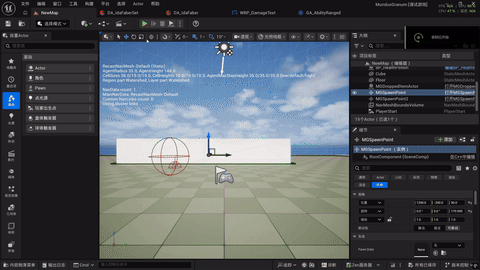

</details>

### 角色移动模式的状态机
声明FGameplayTagBlueprintPropertyMap类型的变量将一个标签与一个bool变量绑定。手持武器时切换动画蓝图。

<details>
<summary>点击查看演示 GIF</summary>

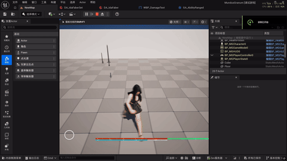

</details>

### 数据驱动的Character生成
派生一个ATargetPoint，角色的数据资产作为成员变量让TargetPoint在它的位置生成一个指定类型的Character，它的初始化流程融合进了玩家操控的Character的模块化初始化流程。

<details>
<summary>点击查看演示1 GIF</summary>

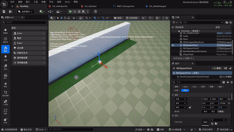

</details>

<details>
<summary>点击查看演示2 GIF</summary>

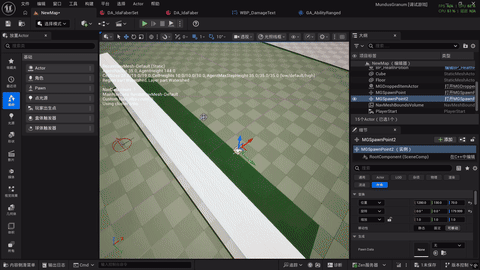

</details>

## 背包系统
学习Lyra的背包系统，绘制了[UML图](/Docs/Inventory_Equipment.drawio)，写了部分逻辑的**单元测试**。主要文件的目录结构如下。
```text
MundusGranum/
└──Source/
   └──MundusGranum/
      ├──Inventory/
      └──Equipment/
```
### 玩家背包与手持物品切换演示
暂时没有UI，gif中演示了空手和手持武器的切换

<details>
<summary>点击查看演示 GIF</summary>

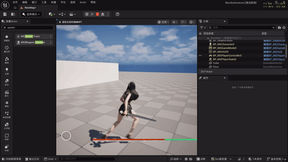

</details>

## GAS
GAS相关演示

### 跳跃能力

<details>
<summary>点击查看演示 GIF</summary>

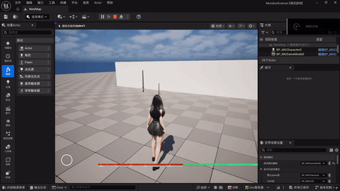

</details>

### 近战能力
缓存左右键标签组合，查找连招数据资产找到要跳转的Montage片段

<details>
<summary>点击查看玩家近战演示 GIF</summary>

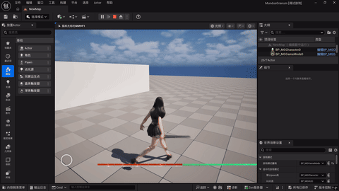
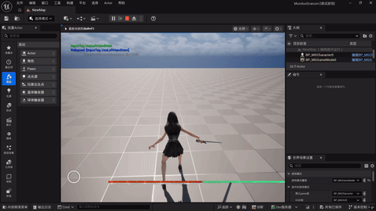
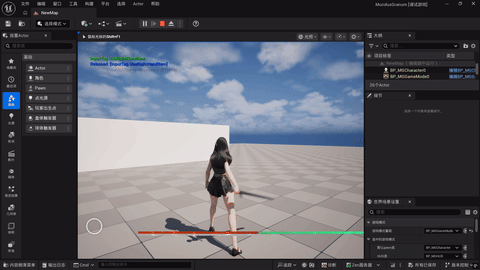

</details>

<details>
<summary>点击查看敌人近战演示 GIF</summary>

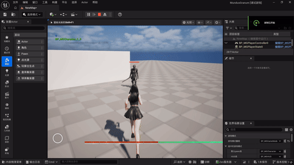

</details>

### 远程攻击

<details>
<summary>点击查看演示 GIF</summary>

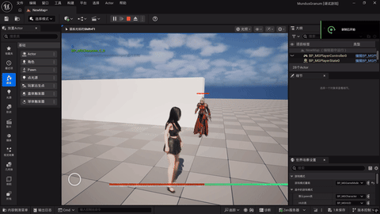

</details>

### 死亡

<details>
<summary>点击查看演示 GIF</summary>

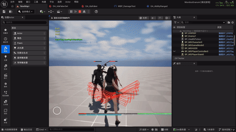

</details>

### 受击

<details>
<summary>点击查看演示 GIF</summary>

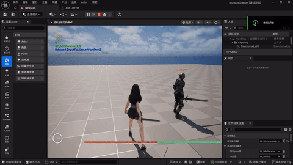

</details>

## 敌人AI
通过编写AI行为树和BlackBoard实现了锁定、追踪玩家并在指定范围内攻击玩家

<details>
<summary>点击查看演示 GIF</summary>

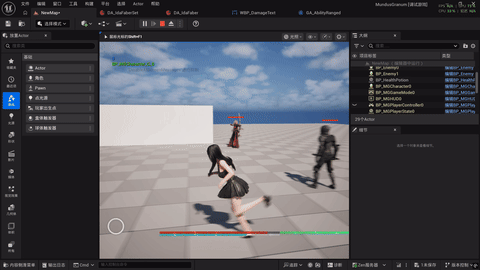

</details>